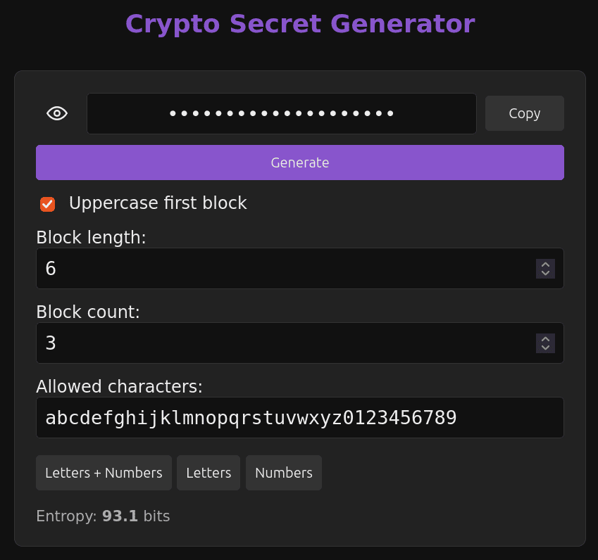

# Crypto Secret Generator

A single-page web app for generating random secrets, API keys, and license-code-style strings. Everything — markup, styles, and logic — lives in one dependency-free `index.html`; just open it in a browser.

## Features

- **Cryptographically secure randomness** — uses the Web Crypto API (`crypto.getRandomValues`) with rejection sampling to avoid modulo bias, so every allowed character is equally likely.
- **Block formatting** — secrets are generated as N blocks of M characters, joined by hyphens (e.g. `a712x9-f3p8q1-zsm4c2`).
- **Configurable options**
  - Block length (1–10) and number of blocks (1–10)
  - Custom allowed character set (duplicates are removed automatically)
  - Uppercase the first block (handy for license keys; the first block is drawn from the uppercased alphabet, the rest from the original one)
- **Presets** — one-click setups for Letters + Numbers, Letters, or Numbers; each preset also sets matching block length and count.
- **Entropy display** — live estimate in bits
- **Clipboard copy** — with visual feedback
- **Show/hide secret** — an eye-icon toggle button
- **Live regeneration** — changing any option regenerates the secret immediately

## Screenshot

